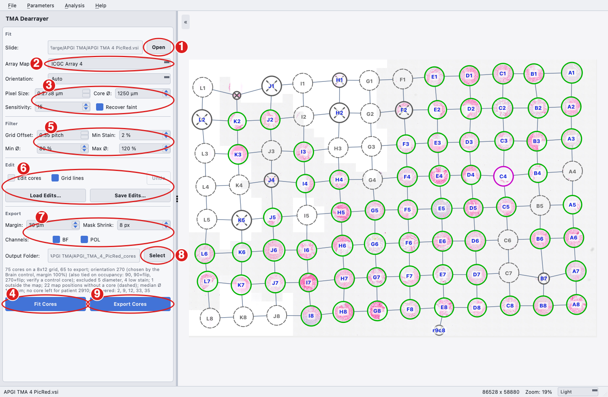

# TMA Dearrayer

Cabana can turn a whole-slide scan of a tissue micro-array into one image and
one binary mask per core, named by patient, ready for batch analysis. The
step lives on the **TMA Dearrayer** page of the GUI and in the `cabana-tma` command.

## What it does

1. **Load slide**: Olympus VS200 `.vsi` scans are read natively (no Java or
   Bio-Formats needed) from the `.vsi` file and its `_<name>_/stack*/` tile
   folders. Plain whole-slide TIFF/PNG exports are accepted too. Bright-field
   and polarised layers of a `.vsi` are exposed as the channels `BF` and `POL`.
   As soon as a slide is chosen a low-resolution preview appears in the image
   panel and the pixel size and available channels are filled in.
2. **Fit cores**: tissue is thresholded on a low-resolution level, a circle is
   fitted to every core, the circles are snapped to the array grid, and the
   grid is matched to the array map: one of the bundled ICGC/APGI arrays 1 to 8,
   or your own map loaded from a file (see [Array maps](#array-maps)). A numbered overlay is shown: green circles will be exported,
   purple were recovered at empty grid positions (also exported), grey with a
   cross were excluded by the quality filters, and grey lie outside the printed
   map; neither grey kind is exported. Thin lines join cores in neighbouring
   grid cells, dashed circles mark map positions that hold no core, and
   control cores carry their tissue name so the orientation can be checked at
   a glance; the lines reach the dashed circles too, so the lattice stays
visible across gaps. Circles can be corrected by hand (see
   [Editing cores by hand](#editing-cores-by-hand)).
3. **Export cores**: for every core and selected channel a square crop is
   written to `<channel>/<group>/Images/` and a circular mask (white inside the
   fitted circle, shrunk by *Mask Shrink*, black in the corners) to
   `<channel>/<group>/Masks/`. Channels are `BF` and `POL`; groups are
   `Patients`, `Controls` (Liver, Brain, … from the map) and `Unmapped` (cores
   without a map entry, e.g. when no array map is chosen, and cores the map
   lists without an identity). A `cores.csv`
   manifest, `overlay.png` and `cores_edits.json` (the cores as exported,
   so hand edits can be reinstated later) are written alongside.

The three stages run independently: fitting can be repeated with new settings
before exporting, and exporting can be repeated into a different folder.

## The TMA Dearrayer page



1. **Open** the slide (`.vsi`, or a whole-slide TIFF/PNG, in which case enter the
   pixel size). A preview appears in the viewer.
2. **Array Map.** Choose the printed ICGC/APGI array (1 to 8) for patient IDs,
   *Load map file…* for your own map (see [Array maps](#array-maps)), or *None*
   to name cores by grid position only. Leave **Orientation** on
   *Auto* unless you need to force one (see [Orientation](#orientation)).
   Changing either after a fit relabels the cores instantly; no refit.
3. **Fit settings.** *Core Ø* is the nominal core diameter and sets the scale
   of every step; *Sensitivity* is the tissue threshold; *Recover faint* looks
   for pale cores at empty grid positions.
4. **Fit Cores** fits the circles and matches the map. The overlay shows every
   core with its number and map position; the status line below the settings
   summarises the fit and any warnings.
5. **Filter.** Quality gates applied after fitting; they update the overlay
   instantly without a refit (see [Quality filters](#quality-filters)).
6. **Edit.** *Edit cores* turns on hand correction of the circles on the
   overlay, *Grid lines* shows or hides the lattice and *Undo* reverts the
   last edit; **Load Edits…** and **Save Edits…** reinstate or keep hand
   edits without exporting (see [Editing cores by hand](#editing-cores-by-hand)).
7. **Export settings.** *Margin* around each circle, *Mask Shrink*, and the
   channels (BF, POL) to write.
8. **Output Folder** for the export. Opening a slide always sets it to
   `<slide>_cores`, placed in the folder that held the output folder you last
   chose with **Select** (remembered between sessions), or beside the slide
   until you have chosen one. One output folder holds one slide's export:
   Export asks before writing into a folder that already holds another
   slide's export.
9. **Export Cores** writes the images, masks, `cores.csv`, `overlay.png` and
   `cores_edits.json`. When it finishes you are offered to point **Batch
   Run** at the exported Patients folder of a channel.

## How core fitting works and how to tune it

1. **Tissue mask.** On a level of about 4 µm/px, a pixel is tissue when its
   HSV saturation exceeds *Sensitivity* (default 15) or it is darker than
   96.5% of the background brightness of its image column (the per-column
   reference cancels scanner banding). The column background is measured only
   from pixels close to the slide's overall background level, so that tissue,
   the white fill of unscanned areas and the faint off-white stripes scanners
   leave there cannot bias it; this matters for partly scanned slides, where a
   column may be mostly unscanned. Flat, unsaturated bright regions away from
   that level (white fill, the grey padding written beyond the scanned frame)
   carry no data and are never counted as tissue.
2. **Clean-up.** Gaps of up to 30% of a core diameter are closed so a core
   becomes one blob; an opening of 10% of a core diameter then cuts off thin
   structures such as coverslip edges, scratches and streaks.
3. **Components.** Blobs smaller than 5% of the largest are dropped. Inside
   each blob detached debris smaller than 5% of the main tissue mass is
   removed, and the minimum enclosing circle of what remains is the core.
   Circles larger than 1.5 or smaller than 0.2 nominal core diameters are
   rejected (fused neighbours, dust).
   Because an enclosing circle is set by its outermost points, debris next
   to a core would inflate it. Circles larger than 110 % of the slide's median
   radius are therefore rebuilt from the largest tissue piece (split at thin
   attachments if it is itself too large), adding neighbouring pieces nearest
   first only while the circle stays within that size.
4. **Grid.** The slide's rotation is estimated from the median angle between
   horizontally adjacent cores and removed, so a tilted array (the APGI
   slides are tilted by up to 3°) does not smear one row into the next.
   Circle centres are then snapped to a lattice whose pitch and phase come
   from the well-formed circles only (fill at least 30 %, radius within 20 %
   of the median), so fragments and debris cannot shift the grid. Debris that
   is both malformed and off the lattice is kept but does not widen the grid.
   Circles falling in one cell are merged largest
   first, and a smaller one is only merged if the result stays within 110 % of
   the typical core radius, so a debris speck in the same cell is dropped
   rather than enlarging the core.
5. **Recovery.** With *Recover faint* on, every empty grid position is tested
   with a permissive threshold (half the saturation, twice the brightness
   margin). If at least 3% of the expected disc is tissue, a core is added
   there with the median radius and flagged `recovered` (purple on the
   overlay). Positions with less tissue stay empty.
6. **Fill.** The fraction of each circle covered by tissue is recorded in
   `cores.csv` (`fill`) for reference.

Tuning: lower *Sensitivity* (for example 8) when very pale cores are missed
and debris is not a problem; raise it (25 to 30) when shading or dust on the
glass is being fitted. *Core Ø* sets the scale of every morphological step
and of the size gates, so set it to the real core diameter first. On the
command line the same knobs are `--sat-thresh`, `--val-ratio`, `--min-fill`
and `--no-recover`.

## Quality filters

After the cores are fitted and patient IDs assigned, each core is measured and
checked against the **Filter** settings. Excluded cores stay in `cores.csv`
(columns `excluded`, `reason`, plus the measured `grid_offset`, `diameter_um`,
`fill`, `stain_frac`), are drawn grey with a cross on the overlay, and are not
exported. Filters update instantly; no refit is needed.

| Setting | Excludes a core when | Default |
|---|---|---|
| Grid Offset | its centre is further than this from its grid position, in core spacings | 0.35 |
| Min Ø / Max Ø | its fitted diameter is outside this range, as % of Core Ø | 80 % / 120 % |
| Min Stain | less than this fraction of the circle has HSV saturation above 40, i.e. the core is empty or unstained (control cores exempt) | 2 % |

Filters never change patient IDs. The orientation match ignores only objects
more than half a core spacing from any grid position, a fixed rule, and all
filters run after IDs are assigned. The status line reports how many cores each
filter removed, the median fitted diameter (with a warning when Core Ø differs
by more than 10 %), and any patient left with no core.

On the APGI slides the weakest genuine patient cores have 3 to 5 % stained
area and the Brain and Muscle controls about 0 to 1 %, which is why the stain
default is 2 %. Core Ø defaults to 1250 µm, the fitted size of the APGI
cores; the diameter range is only meaningful when Core Ø matches the array, so
change it for other arrays (the status line warns when the median fitted
diameter differs from Core Ø by more than 10 %). Partial or torn cores fit a
smaller circle; lower Min Ø (for example to 70 %) to keep them.

CLI: `--max-grid-offset`, `--diameter-range MIN MAX`, `--min-stain`, and
`--stain-sat` (the saturation threshold, 40, not exposed in the GUI).

## Editing cores by hand

The fit is right on the APGI slides, but a partial core excluded by the
diameter filter, a circle inflated by a neighbouring fragment, or a pale core
the recovery pass missed are quicker to fix by hand than by retuning. Tick
**Edit cores** and work on the overlay:

| Gesture | Effect |
|---|---|
| Click a circle | Select it (yellow dashed halo; its colour keeps showing its status) |
| Drag inside a circle | Move the core |
| Drag the rim, the yellow handle, or Shift+drag inside | Resize the core |
| Double-click a circle | Include it if excluded, exclude it if included (overrides the filters) |
| Double-click empty space or a dashed placeholder | Add a core there (median radius) |
| Delete / Backspace | Remove the selected (yellow) core |
| Ctrl+Z, or **Undo** | Revert the last edit |
| Right-click | Menu with the same actions, *Let filters decide* to drop an override, and *Set map position…* (see [Correcting the map placement](#correcting-the-map-placement)) |

Hovering a core shows its number, map position, patient ID or tissue,
diameter, fill, stain and filter status, plus a reminder that a wrong label
can be corrected by right-clicking the core. Labels on the overlay give the map
position and core number (the grid cell when no array map is chosen), and
control cores their tissue name. Dashed circles mark positions without a
core: the map positions when an array is matched, otherwise the empty cells of
the fitted grid.
The core under the cursor is drawn with a thicker ring, the selected one
carries a yellow halo.
Panning (drag on empty space) and zooming keep working while editing. No
label is ever typed: a moved or added core takes the patient ID of the grid
cell it lands in, computed from the fitted lattice and the current
orientation, so the map stays the single source of identities. After each
edit the core's diameter, grid offset and stain are re-measured, the quality
filters re-run, the grid lines follow, and the status line counts the
hand-edited cores. Hand-edited cores carry an orange dot on top of their ring on the overlay
and `manual = 1` in `cores.csv`; an override is recorded as reason `manual`
when it excludes a core.

Edits are saved with every export as `cores_edits.json` next to `cores.csv`,
and **Save Edits…** saves them at any time without exporting (by default to
the same file in the output folder; choose another name to keep a copy that
an export never replaces). The file holds the complete set of cores, the
orientation in use and any map position set by hand, so reinstating it
replaces the new fit.

Fitting the same slide again with that output folder offers to reinstate the
file when it holds hand-edited cores or a hand-set map position.
**Load Edits…** reinstates any edits file at any time, for example one from
another folder or one saved for a rescan of the same array (it asks before
loading edits saved for a different slide name; edits for a different array
are refused). On the command line use `--edits FILE`.

Export replaces the output folder's `cores_edits.json`. When that file holds
hand edits of this slide but the cores on screen have none, typically after a
refit whose offer was declined, Export asks before replacing it, so saved
corrections are not lost by accident.

The saved orientation is the one in use at the time, whether it was confirmed
or chosen by *Auto*. On reinstating it is applied when **Orientation** is
*Auto*; an orientation chosen explicitly takes precedence.

## Output naming

```
<patientID>.vsi - <slide>_<channel>_<position>Annotation (<class>)_<n>.png   e.g. 1734.vsi - TMA1_BF_A4Annotation (Tumor)_1.png
<tissue>.vsi - <slide>_<channel>_<position>Annotation (<tissue>)_<n>.png      e.g. Liver.vsi - TMA1_BF_A1Annotation (Liver)_1.png   (control cores)
<slide>-<position>.vsi - <slide>_<channel>_<position>Annotation (Unknown)_1.png   e.g. TMA1-B3.vsi - TMA1_BF_B3Annotation (Unknown)_1.png   (core the map marks ?)
<slide>-r<row>c<col>.vsi - <slide>_<channel>_r<row>c<col>Annotation (Unmapped)_1.png   (no array map selected or unmapped cell)
```

The names follow the pattern of the QuPath slide exports Cabana was built
around, so that the per-patient statistics and scores of a batch run identify
the patient from the prefix before `.vsi`, the channel from `_BF_`/`_POL_`,
the class from the last bracket and the replicate from the trailing number.
`<class>` is the map's class for the core where one exists (for example PNET,
MCN), otherwise `Tumor`; `<n>` numbers the patient's cores on the slide in
row-major order. `position` is the position on the map: for the built-in
arrays the flat position (rows A to L, columns 1 to 8) after the printed
sector offsets are resolved, for your own maps the row letter and column
number of the cell (`R<row>C<col>` when rows are numbered). For the built-in
arrays `<patientID>` is the 4-digit patient ID printed under each cell of the
ICGC map, and the APGI block ID printed above it is in `cores.csv`. Cores your
map marks `?` go to `Unmapped`, named by slide and position. Extra columns of
a map file are added to `cores.csv`. `cores.csv` records the map label,
sector, patient ID, block ID, tissue, circle centre and radius (level-0 pixels),
tissue fill, QC metrics, flag, exclusion reason, export group (`Patients`,
`Controls` or `Unmapped`), the orientation used together with the rule
that decided it (`orientation_method`), and whether the core was edited by
hand (`manual`). Map positions that hold no core are listed too, with flag
`missing`, their scan cell and the lattice-predicted centre, so the manifest
covers every position of the printed map.

## Orientation

The scan is typically rotated relative to the printed map. *Auto* compares the
pattern of missing cores with the map for all eight rotations and mirror
images, sliding the turned map across the fitted grid to find where it sits.
An edge row or column that is empty on the printed map (row L of arrays 1
and 2) is allowed to lie outside the fitted grid, so stray tissue beside the
array cannot push the map out of place. A fully populated array cannot distinguish a rotation from its mirror
image, so when several orientations tie Cabana breaks the tie by appearance:

1. **Brain control.** Brain tissue is nearly collagen-free, so the core at
   the map's Brain position must be almost unstained (under 5 % stained area,
   and clearly paler than under the other candidates). Arrays 1 to 5 have a
   Brain core.
2. **Replicate similarity.** Each patient's three cores come from one tumour
   and should look alike (stained fraction, saturation, darkness, fill; each
   feature is z-scored across the slide so none dominates). Under a wrong
   orientation the "triplets" are unrelated patients. The orientation with
   the most self-similar triplets wins if it leads the runner-up by at
   least 10 %.

The status line and `cores.csv` (`orientation_method`) say which rule decided
and by what margin. If neither rule separates the candidates the orientation
is **unresolved**: the overlay still shows provisional labels, but Export is
disabled until you confirm a control core against the printed map and set the
orientation explicitly (the CLI exits with an error unless `--orientation` is
given). Orientation genuinely differs between slides of this set, so never
assume one value for a batch.

To check an orientation, look at the control cores: they are named on the
overlay (Liver, Brain, Lung, Placenta, …), and Brain in particular must land
on a pale, nearly unstained core. Changing **Orientation** relabels the
fitted cores at once, so cycling through the candidates until the control
names match the slide takes seconds.

### Correcting the map placement

Choosing an orientation fixes how the map is turned, but Cabana still works
out where the map sits on the fitted grid. That placement can be wrong, for
example when stray tissue beside the array is fitted as extra cores and an
edge row of the map is empty: every label is then shifted by a row, whatever
the orientation. Moving cores does not help, because a moved core simply
takes the label of the grid cell it lands in.

To fix it, tick **Edit cores**, right-click a core you can identify (a
control is easiest: lung, liver, brain, …) and choose **Set map position…**.
Pick its true position from the list (controls are listed first, then every
map position with its patient ID). The current orientation is kept and the
whole map is shifted so that this core gets the chosen position; every other
core is relabelled from it. Then check a second control on the far side of the
array: if it is wrong too, the orientation is wrong, so choose another one in
**Orientation**. The map then turns about the pinned core, which keeps its
position.

A hand-set placement counts as resolved, so it enables **Export** even when
*Auto* was unresolved. The status line and `cores.csv` show
`orientation_method = anchor`. It is saved in `cores_edits.json` and comes back
with the other edits. **Clear map position** in the same menu, choosing
*Auto*, or choosing another array returns to the automatic placement, and
**Undo** reverts it like any other edit.

## Array maps

The map tells Cabana which patient or control tissue sits at each position of
the array. The eight ICGC/APGI arrays are built in. For any other TMA, write
the map into the template and choose **Load map file…** under **Array Map**.

### Filling in the template

**File > Generate TMA Map Template…** (or `cabana-tma map template FOLDER`) writes
`tma_map_template.csv`. Open it in Excel or another spreadsheet program: it is
a grid with row letters A to L and column numbers 1 to 12 ready, and an
example map to replace. Add letters or numbers if your array is larger; rows
and columns you leave unused do no harm.

Each cell is one position on the array, where it physically sits:

| Cell | Meaning |
|---|---|
| blank | no core at this position |
| `?` | a core whose ID is unknown |
| `ctrl:<tissue>`, e.g. `ctrl:Liver` | a control core |
| anything else | the patient ID that names the core's images |

```
map,TMA1
cell lines,position patient block class
,1,2,3,4,5,6
A,ctrl:Liver,1001,1002,1003,1004,ctrl:Brain
B,1005,1006,?,1007,1008,1009
```

Several maps can share a file: start each with a row holding `map` in the
first cell and the map's name in the second. Name each map as it appears in
the slide file names (for example `TMA3` for `APGI TMA 3 PicRed.vsi`) and the
right map is preselected when you load the file.

### Pasting from a PDF or another table

Cells pasted from a PDF table usually hold several lines, for example the
printed position, the patient ID and a block ID. The **cell lines** row under
the `map` row names those lines in order, using `position`, `patient`,
`block`, `class` and `skip`. The template's row, `position patient block
class`, reads a pasted cell `A2 / 3000 / 8064399` as patient 3000 with block
8064399. A line in brackets such as `(MCN)` is the annotation class, and a
cell with no digits after its position, such as `A1 / Liver`, is a control.
Change the row to match your source, or delete it if you type one value per
cell. A cell holding a single value is always read as in the table above.

Two things to fix after pasting:

1. **Place the cells where they sit on the array.** Many printed maps restart
   their labels in each sector (the ICGC maps print A1 to D8 three times).
   Paste each sector under the previous one and give its rows the following
   letters (E to H, I to L, …); Cabana takes the position from the grid, not
   from the printed label.
2. **Check every row has its letter and every column its number.** A row
   without its letter, or more cells than column numbers, makes the file
   unusable, with a message that says which line to fix.

### Checking the map

On loading, Cabana shows each map as a coloured grid (patients, controls,
unknown cores, empty positions) with any problems. Errors make the file
unusable: a position listed twice, a row without its label, too few column
numbers, a pasted cell whose lines do not match the cell lines row, or a
multi-line cell without a cell lines row. Warnings flag likely typing
errors, such as a prefix other than `ctrl:`, a patient listed more than three
times, or a cell holding only something like `A1`. **Compare the grid with
the original map before choosing Use This Map**: a wrong ID silently puts a
core under the wrong patient.

`cabana-tma map check FILE` prints the same check as text.

### Other file types

Files may be comma-, semicolon- or tab-separated (`.csv`, `.tsv`, `.txt`), and
lines starting with `#` are ignored. A QuPath `.qpmap` grid loads as it is;
add `ctrl:` in front of its control tissues and use `?` where a core has no
ID. Cabana does not read PDFs or images of maps: paste their tables into the
template as above.

A table with one line per core is also accepted, for maps exported from a
database: columns `row` and `col` (required), `patient_id`, `tissue`, `class`,
`block_id`, `map` (for several maps in one file) and `status` (`empty` for a
position without a core); positions not listed have no core and other columns
are copied to `cores.csv`. `cabana-tma map convert FILE OUT.csv` writes any
accepted file in this form.

The saved edits (`cores_edits.json`) record which map they were made with, by
name and by a fingerprint of its contents, so they are never reinstated on a
different map.

## Using the export in Cabana

Each group folder is a self-contained batch input: `BF/Patients/Images/` is
the input folder and `BF/Patients/Masks/` the ROI-mask folder of **Batch
Run**, and likewise for `Controls/` and for `POL/` (the GUI's "Use BF in Batch
Run" and "Use POL in Batch Run" point at the Patients folders). Keep the
controls for checking staining consistency between slides. To collect every
slide's controls in one `<channel>/Controls/`, select the same output folder
for each slide and confirm Export's warning; `cores.csv`, `overlay.png` and
`cores_edits.json` then describe only the last slide exported there. Controls are exempt from the stain filter but not from
the grid-offset and diameter filters. Run the channels separately: bright-field with
Dark Line on, polarised with Dark Line off. With a mask, the corners of each
crop are excluded from segmentation, fibre detection, HDM, fibre-area and gap
metrics, and the percentage metrics are relative to the circle area. The
masks are honoured whether segmentation is enabled or not.

Cores scanned at 20x are about 4000 to 5000 pixels across. Raise
`Segmentation: Max Size` in the parameter file (for example to 6000) so that
each core is analysed as one image, and consider `Segmentation: Patch Size`
(for example 1024) so the segmentation network sees the tissue at a useful
resolution instead of the whole core shrunk to 512 pixels.

## Command line

```bash
cabana-tma "APGI TMA 1 PicRed.vsi" out/TMA1 --array 1 --slide-name TMA1
cabana-tma slide.tif out/slide --pixel-size 0.5 --fit-only        # cores.csv + overlay only
cabana-tma slide.vsi out/x --array 4 --orientation 90+flip --channels BF
cabana-tma slide.vsi out/x --array 4 --edits out/x/cores_edits.json  # reinstate hand edits
cabana-tma slide.vsi out/x --map my_maps.csv --map-name TMA7         # your own map
cabana-tma map template maps/            # write the map template
cabana-tma map check my_maps.csv         # list problems and draw each map as text
cabana-tma map convert my_maps.qpmap my_maps.csv   # rewrite in the list layout
```

Run `cabana-tma --help` for all options (core diameter, crop margin, mask
shrink, channel selection).

## Python API

```python
from cabana import TMAPreprocessor

pre = TMAPreprocessor("APGI TMA 1 PicRed.vsi", array_number=1, slide_name="TMA1")
# or your own map:
#   from cabana.tma_maps import load_map_file
#   mf = load_map_file("my_maps.csv"); assert mf.ok, mf.problems
#   pre = TMAPreprocessor("slide.vsi", tma_map=mf.maps[0])
pre.fit()                      # list of Core objects with centre, radius, grid position
pre.map_to_array()             # orientation, sets map positions; pre.orientation_ties lists ambiguities
pre.missing_positions()        # map positions without a core, with the lattice-predicted centre
core = pre.add_core(x, y)      # hand edits: add_core, move_core, resize_core, remove_core,
pre.set_override(core, "include")   # set_override; each re-snaps to the grid and re-filters
pre.set_map_position(core, 10, 7)   # place the map by hand: this core is map cell K8 (row/col from 0)
pre.export("out/TMA1", channels=["BF", "POL"])   # also writes cores_edits.json
pre.load_edits("out/TMA1/cores_edits.json")      # reinstate after a refit
```
