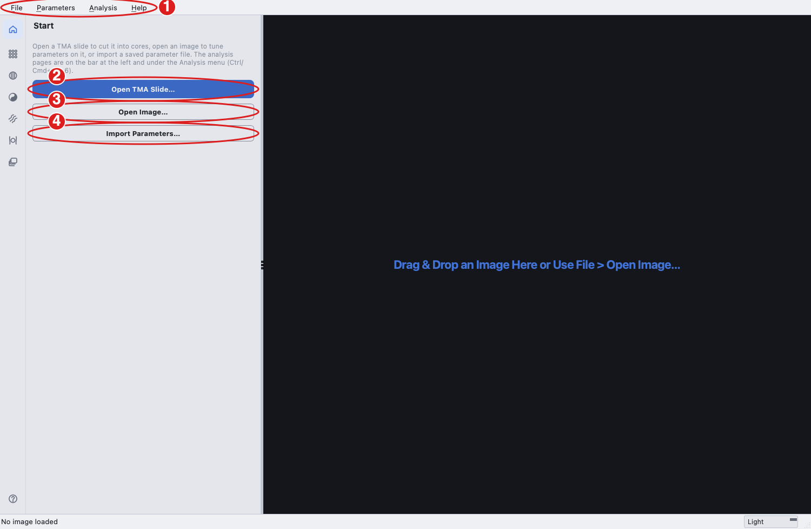
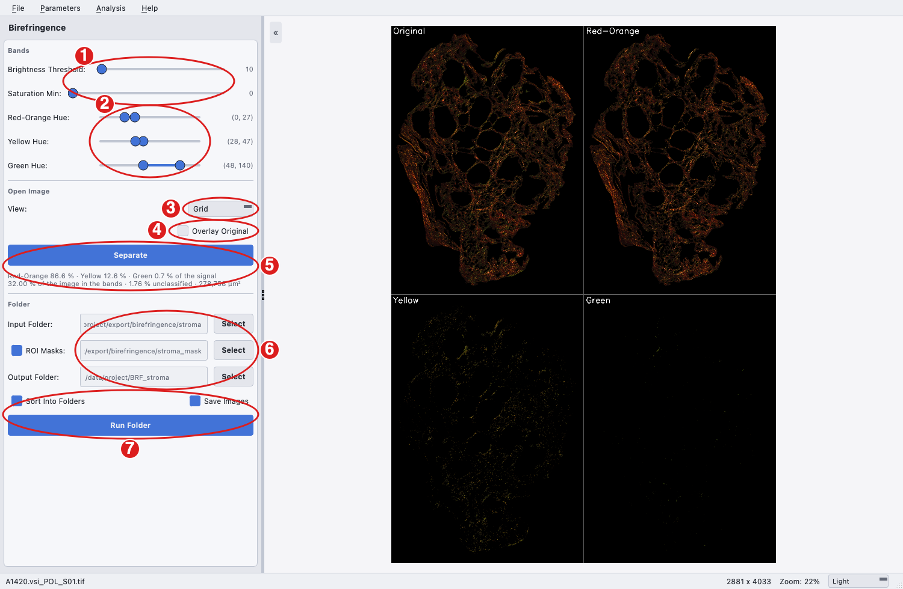
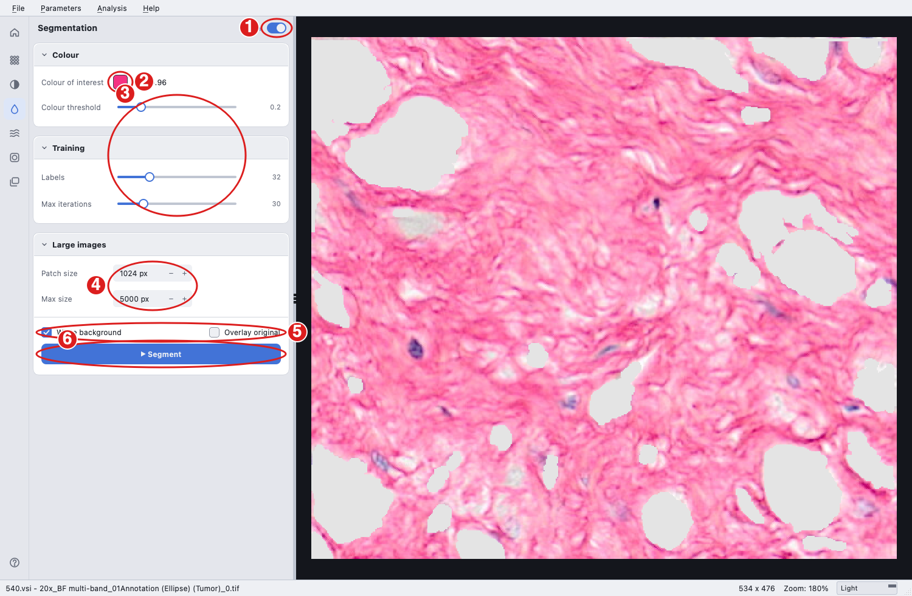
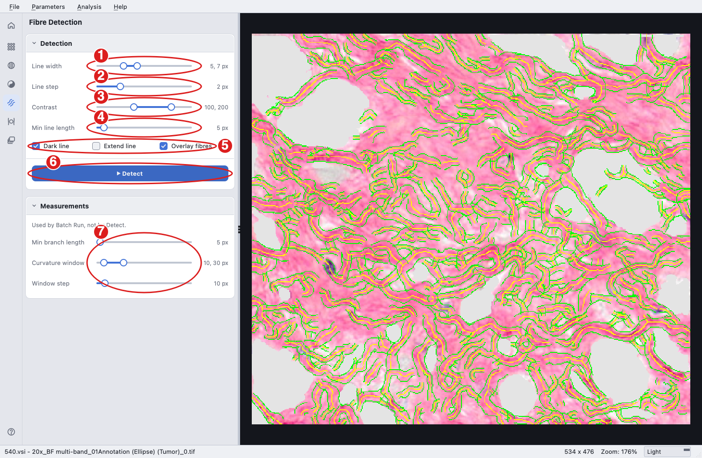
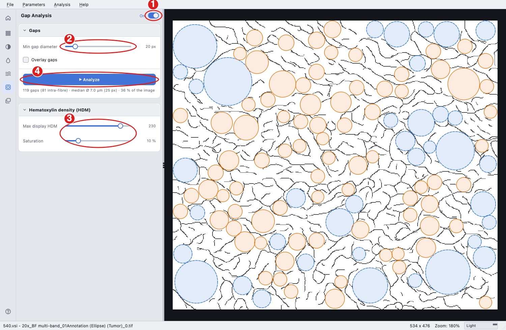
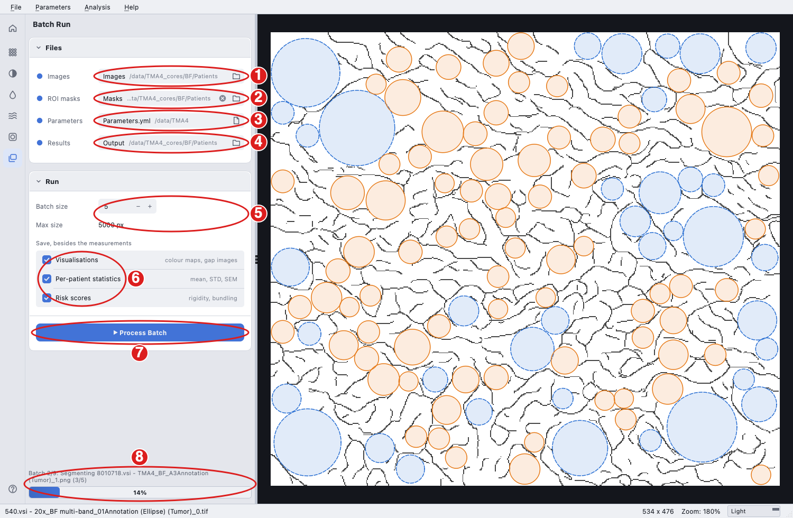
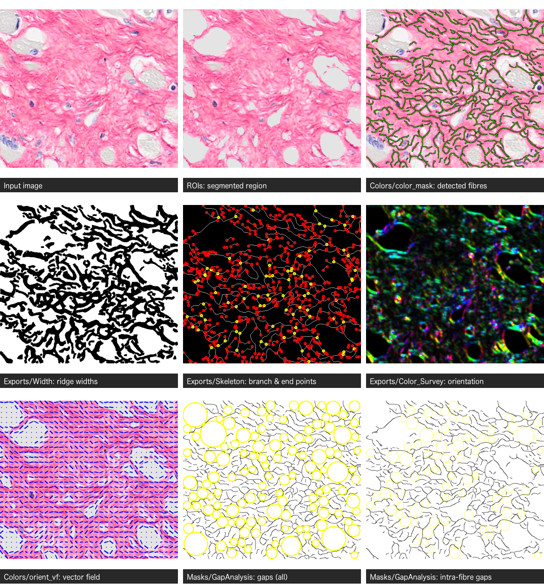

# Image Analysis Workflow

Once the Cabana GUI is launched, you will see a window split horizontally: the control panel on the left and the image viewer on the right. The program is designed to let you:

1. cut tissue micro-array (TMA) slides into per-core images and masks ready for batch processing (optional, see [TMA preprocessing](tma.md)),
2. experiment with parameters for different components using your data, and
3. export the optimised parameters for batch processing on larger datasets.



1. **Menu bar.** All commands live here: **File** (open or reload an image, open a TMA slide, generate a TMA map template, quit; quitting asks for confirmation only when a job is running or TMA hand edits are unsaved), **Parameters** (import, export, restore defaults), **Analysis** (choose which page the control panel shows: **TMA**, **Birefringence**, **Segmentation**, **Fibre Detection**, **Gap Analysis** or **Batch Run**, shortcuts Ctrl/Cmd+1 to 6) and **Help** (about, documentation, issue tracker, **Check for Updates** (see [Updating Cabana](installation.md#updating-cabana); on macOS it is in the **Cabana** menu), version, licence).
2. **Open TMA Slide** opens a whole-slide scan on the TMA Dearrayer page.
3. **Open Image** loads a single image to tune parameters on; the panel switches to Segmentation automatically. You can also drag an image onto the viewer.
4. **Import Parameters** loads a saved `Parameters.yml` into the controls.

The control panel shows one page at a time, its settings grouped in collapsible cards (click a card's title to fold it). Hover any label or control for a short description; the same hint appears in the status bar at the bottom, which also shows the loaded file, its size and the zoom. The theme selector sits at the bottom right.

To begin, select a representative image from your dataset, then work through the Segmentation, Fibre Detection and Gap Analysis pages in that order to determine the settings for your analysis. For polarised-light (birefringence) images, the Birefringence page separates the red-orange, yellow and green colour bands, one image or a whole folder (**Run Folder**). Its settings are not part of the parameter file. The band images it writes can then be analysed like any other images: tune and export a polarised-light parameter file (segmentation off, **Dark line** off) and use it on the Batch Run page.

## Birefringence



Under polarised light, Picrosirius Red stained collagen shines red-orange, yellow or green, roughly from thick, densely packed fibres to thin, loosely packed ones. This page classifies the pixels of a polarised-light image into these colour bands as the CMM Lab PR-BRF Analyser ImageJ macro does; with the default settings the band pixel counts equal the macro's. A note appears when the open image looks bright-field, where the bands are meaningless.

The page has two cards: **Bands**, how pixels are assigned to the bands, checked on the open image with **Separate**, and **Folder run**, which applies them to every image of a folder.

1. **Min brightness** (default 10): darker pixels are background. **Min saturation** (default 0): less saturated pixels belong to no band; at 0, grey pixels count as red-orange, as in the macro.
2. **Red-orange, Yellow and Green hue.** The hue range of each band on ImageJ's 0 to 255 scale (defaults 0-27, 28-47 and 48-140, those of the macro). The bands stay joined: moving one edge moves the neighbouring band. Drag the red-orange band below 0 to include the deep red hues just below the wrap point (shown as, for example, 230-27); the default band leaves them out and reports them as unclassified.
3. **View.** *Grid* (the default) shows the original image and the red-orange, yellow and green bands side by side; *Total* and each band show those pixels in their original colour on black, as they are saved; *Class map* paints each band in its colour and bright pixels in no band in grey, the quickest way to judge the band limits.
4. **Overlay** (next to View) shows the original image.
5. **Separate** computes the bands of the open image; afterwards every setting updates the view at once. Below the button: each band's share of the birefringent signal, the share of the image in any band and in none (unclassified), and the area in the bands (when the image records its pixel size).
6. **Run on a folder.** Colour separation of every image in the **Input folder** with the settings above, without segmentation or fibre analysis. Click a field or its folder icon to choose the folder. **ROI masks** (optional) restricts the measurement of each image to its mask, matched by name as in Batch Run; leave it empty to measure whole images (the clear icon in the field empties it). When the input folder is a QuPath export such as `stroma`, its `stroma_mask` folder (or the `Masks` folder next to a TMA export's `Images`) is filled in automatically. Results go to the **Output folder**; files of the same names are replaced and nothing else is deleted.
7. **Sort into folders** (default on) puts the band images in `Total`, `Red`, `Yellow` and `Green` and the tables in `Stats`. **Save images** (default on) writes the band images; untick it to write only the tables. **Run Folder** starts the run and turns into **Cancel** while it runs; a progress bar shows the image being separated.

The settings start at the macro's defaults every time Cabana starts and are not saved in the parameter file. The output folder of **Run Folder** holds `Total/<image>_total.tif` (every pixel in a band, in its original colour) and `<image>_original.tif`, `Red/<image>_red_orange.tif`, `Yellow/<image>_yellow.tif`, `Green/<image>_green.tif`, `Stats/<image>_statistics.csv` and `Stats/ResultsBRF.csv` with one row per image (see [Read-outs](readouts.md#birefringence-colour-bands)), and `BRF_Settings.yml`, a record of the settings and folders used. The images are TIFFs carrying the pixel size; large sections are processed in strips, so they need little more memory than the image itself.

## Segmentation



1. **On/off switch** (next to the page title). Turns the segmentation step on or off for both the GUI and batch runs. If the background is clean, segmentation may not be needed.
2. **Colour of interest.** Click the swatch to pick the stain colour directly from the image; its normalised **Hue** (in [0, 1], HSB/HSV colour space) is shown next to it. To pick from the original image again, use **File > Reload Image**.
3. **Colour threshold** is the minimum colour score (1 = exactly the colour of interest) for a segment to count as region of interest (ROI); after a segmentation, moving the slider updates the result at once. In the **Training** card, **Labels** controls the granularity of the segmentation and **Max iterations** limits the training of the segmentation network.
4. **Large images.** **Patch size** (1024 px by default): larger images are segmented in overlapping square patches. The network is trained once on the whole image and then labels each patch at a higher resolution, so fine detail survives on images of several thousand pixels such as TMA cores. Off shrinks the whole image to 512 px. **Max size** (5000 px by default) is the largest image a batch run analyses as one piece: images with more pixels than its square are split into blocks of at most this size, each analysed (and segmented) as a separate image. *No limit* analyses every image whole, and very large images may run out of memory; the smallest value is 2048 px. It is saved with the other parameters by **Parameters > Export**. A note below the two boxes says when the open image would be split in a batch run (the segmentation preview always uses the whole image), and when Patch size is so large that it cannot apply to the blocks.
5. **White background.** Fills the non-ROI area with white (default). Disable it when detecting bright fibres on a dark background. **Overlay original** blends the segmentation with the original image in the viewer.
6. **Segment** runs the step; the result replaces the image in the viewer.

## Fibre Detection



1. **Line width.** Minimum and maximum width of the ridges to detect, in pixels.
2. **Line step.** Sampling interval for line widths between the minimum and maximum, in pixels.
3. **Contrast.** Lower and upper greyscale contrast thresholds between fibres and background.
4. **Min line length.** Shorter fibres are ignored (pixels).
5. **Dark line** detects dark fibres on a light background (Picrosirius Red); disable it for bright fibres on a dark background (fluorescence, SHG). **Extend line** enables detection near junctions and may produce artefacts, so use it with caution. **Overlay fibres** draws the detected fibres over the image in the viewer.
6. **Detect** runs the step on the segmented image when segmentation is enabled, otherwise on the original.
7. **Measurements.** Settings used when the analysis runs (Batch Run), not by **Detect**: **Min branch length** prunes shorter side branches of the fibre skeleton before length, branching and curvature are measured; **Curvature window** and **Window step** set the window sizes (pixels) over which curvature is measured, one Curvature column per window.

## Gap Analysis



1. **On/off switch** (next to the page title). Turns the gap analysis step on or off for the GUI and batch runs.
2. **Min gap diameter.** The smallest gap to report, in pixels.
3. **Hematoxylin density (HDM).** **Max display HDM** is the maximum intensity value of the high-density matrix; **Saturation** is the share of pixels (%) saturated when the HDM contrast is stretched. Both are used when the analysis runs (Batch Run), not by **Analyze**, and stay active when gap analysis is off.
4. **Analyze** fills the gaps between the detected fibres with circles: orange for intra-fibre gaps (inside the segmented region) and blue with a dashed outline for the others. Below the button it shows how many gaps were found, how many are intra-fibre, their median diameter and how much of the image they cover. **Overlay gaps** shows the circles over the faded tissue image, with the fibres drawn on top.

## Exporting parameters

Once the settings on the three pages are chosen, use **Parameters > Export Parameters** to write them to a parameter file, for example `Parameters.yml`, for batch processing. **Parameters > Import Parameters** loads such a file back into the controls and **Parameters > Restore Defaults** resets them. Parameters with no control in the GUI (for example `Segmentation: Min Size` or the curvature windows) can be edited in the file directly; see [Parameter Details](parameters.md).

## Batch Processing



The **Data flow** card lists what goes into the run and where the results go; click a field or its folder (or file) icon to choose it, in any order.

1. **Images.** The folder of images to quantify (tif, png and jpg are supported).
2. **ROI masks** (optional). A folder of binary masks named like the input images (white = analyse, black = ignore), such as a `BF/Patients/Masks/` or `POL/Patients/Masks/` folder written by the TMA Dearrayer page, restricts every measurement to the masked region. Leave it empty to rely on segmentation alone; the clear icon in the field empties it. The mask folder is a per-run path like the input and output folders; it is not stored in the parameter file, but the folder used is recorded in `version_params.yaml` in the output folder.
3. **Parameters.** The exported `Parameters.yml`. Review it first, for example to disable segmentation or gap analysis.
4. **Results.** Where the results are written.
5. **Batch size.** Images are processed in batches (default 5) so that an interrupted run can be resumed. **Max size** shows the parameter file's `Configs: Max Size` (see the Segmentation page); it cannot be changed here, so the parameter file kept with the results describes the run. To use another value, set it on the Segmentation page and export the parameters, or edit `Max Size` under `Configs` in the file.
6. **Save.** The measurements are always written; **Per-patient statistics** and **Risk scores** add per-patient statistics (`QuantificationResults_MEAN_STD_SEM.csv`) and collagen risk scores (`QuantificationResults_SCORES.csv`); they require the TMA naming scheme. **Visualisations** (from the parameter file's `Configs: Save Visualisations`, on by default) saves the colour maps and gap overlay images; untick it to keep only the measurements (CSV files, maps and masks), which cuts storage about fivefold for TMA cores.
7. **Process Batch** starts the run; the button turns into **Cancel** while it runs.
8. While a run is in progress a status line above the progress bar names the current batch, stage and image. The bar weights segmentation by its cost (one CNN training run per image, plus one labelling pass per patch), so it keeps moving through that slow stage.

If a run is cancelled or stops with an error, the completed batches and a checkpoint are kept. Start Batch Run again with the same output folder and accept the resume prompt to continue from the last finished batch. A resumed run always uses the parameters and ROI mask folder it started with, which are saved in the output folder, whatever is selected on the page, so one run never mixes two sets of parameters. When the selection differs, the resume prompt lists the differences; choose **No** to start a new run with the selected settings instead.

## Image naming for per-patient statistics

**Per-patient statistics** and **Risk scores** group the analysed images by patient, so Cabana has to read the patient from the image file name. Name your images as the QuPath export script does, and every field below is recovered automatically:

```
<patient>.vsi - <anything>_<BF|POL>_<anything>Annotation (<sample type>)_<ROI number>
```

| Field | Rule | Example value |
|---|---|---|
| Patient / sample ID | Everything before `.vsi` (or `.czi`). A leading `_` or space is ignored. A channel token (`red`, `green`, `yellow`, `original`, `total`) separated by `_`, `-`, `.` or spaces elsewhere in the name, as in `..._1_red_roi.png`, is appended to the ID (`K324_red`) so channels are tabulated separately. | `K324` |
| Image type | `BF` or `POL` between underscores or spaces anywhere in the name | `BF` |
| Sample type | The content of the last bracket after `Annotation`. Shape brackets QuPath adds, such as `(Ellipse)`, are skipped. Spaces are kept. | `Stroma FNA` |
| ROI number | The first number after the last closing bracket | `1` |

Examples that all parse correctly:

```
K324.vsi - 20x_BF_01Annotation (Tumor)_1.tif
K324.vsi - 20x_POL_01Annotation (Stroma FNA)_12.tif
540.vsi - 20x_BF multi-band_01Annotation (Ellipse) (Tumor)_0.tif
2119.vsi - TMA4_BF_A3Annotation (Tumor)_2.png             (a core exported by the TMA Dearrayer page)
```

Cores exported by the TMA Dearrayer page already follow this pattern (see [Output naming](tma.md#output-naming)): the patient ID comes from the array map, the sample type is the map note or `Tumor`, and the ROI number counts the patient's cores on the slide. Images without `.vsi` in their name are grouped by the first word before a space or underscore, so `K324_BF_tumour_1.tif` still gives patient `K324`, image type `BF` and ROI number `1`, but no sample type, because there is no `Annotation (…)` part. The per-patient table lists the image type and sample type of each patient's first image, so keep BF and POL images in separate runs.

## Cabana Outputs

Cabana generates an output folder containing the subfolders below. The figure shows the main per-image result images for the sample Picrosirius Red image.




i. **Batches**

   Stores the results of each analysis batch. Cabana processes images in batches to allow the use of a check-point in case the analysis run crashes and needs to be restarted (see below under 'errors'). The results of all batches are combined into the folders below, after which the Batches folder and the checkpoint are removed automatically. They are only left in place when a run fails (the GUI reports the error and keeps everything) or is cancelled, so that it can be resumed by running again with the same output folder; once such a run has been completed or abandoned they can be deleted to save storage space.

ii. **Bins**

   Stores the binary masks resulting from ROI extraction. The ROI regions are highlighted in white while backgrounds are highlighted in black.

iii. **Colors**

   Stores subfolders of each processed image with the images of the following analysis results:

   Visualisations: these images are only written when **Visualisations** is ticked (`Configs: Save Visualisations`). Figures with a colour bar draw the image at its own pixel size.

   a. all_gaps: gaps in the whole tissue, over the faded image: intra-fibre gaps in orange, other gaps in blue with a dashed outline
   b. angular_hist: angular distribution of fibre orientations.
   c. color_coherency: orientation coherency/alignment in a local window =2 for OrientationJ plugin) of the original image. The rule of thumb for the filter size is to be about 3 times the standard deviation (sigma value) in each direction, i.e. window size ~6*2=12px.
   d. colour_curve: detected fibres coloured by curvature class: straight (< 15°), wavy (15 to 45°) or curly (> 45°), one image per curvature window.
   e. colour_energy: vector field visualization of orientation, with vector lengths weighted by energy, i.e., gradient vector magnitude.
   f. colour_length: detected fibres coloured by fibre length. Note: this only applies to fibres without branches.
   g. colour_mask: detected ridges and branches
   h. colour_orientation: fibre orientation in [] within a local window
   i. colour_skeleton: detected fibres with branchpoints (yellow) and endpoints (green)
   j. colour_width: detected ridges with calculated fibre widths
   k. gray_width: widths in terms of integer pixel numbers at ridge points/pixels.
   l. intra_gaps: intra-fibre gaps only (orange), over the faded image
   m. orient_colour_survey: color coding of orientation in HSB colour space, where hue is orientation, saturation is coherency, brightness is the grayscale of the original image.

   

   n. orient_vf: mean fibre direction in blocks containing fibres, coloured by direction; the line length shows how well aligned the fibres in the block are.

iv. **IgnoredImages.txt**

   Lists the input images that were not analysed (too dark or too small). Images larger than Max Size (5000 x 5000 pixels by default) are split into blocks that are analysed as individual images. The working copies of the inputs (formerly kept in an `Eligible` folder) are deleted at the end of a run.

v. **Exports**

   Contains the per-image maps and masks. The maps are TIFFs with lossless (deflate) compression, stored as 32-bit floats:

   a. Coherency: coherency/alignment of orientation in a local neighbourhood
   b. Colour survey: same as above in 3.m
   c. Curve map: curvatures of the detected fibres for selected curvature window sizes
   d. Energy: magnitude of gradient vector 
   e. Length map: pixel intensities represent fibre length in µm, stored as 32-bit floats (float32 TIFF).
   f. Mask: detected fibres and fibre branches
   g. Orientation: orientation angles in radians ranging from to.
   h. Skeleton: shows branchpoints (yellow circles) and endpoints (red circles) of detected fibre spines
   i. Width: ridge detection results with the estimated ridge width

   The gap overlay images are saved once, as all_gaps and intra_gaps in **Colors**.

vi. **HDM**

   Stores the high-density matrix areas as defined in Parameters.yml

vii. **Masks**

   Stores the results of ridge detection and of the gap analysis in the 'GapAnalysis' folder (the per-gap tables, and with **Visualisations** two images for each image). One image features red circles, visualizing the gaps between fibres of the non-segmented image.

   The second image shows green circles depicting gaps within collagen fibre areas (intra-collagen gaps) of the segmented image.

viii. **ROIs**

   Stores the results of the image segmentation.

ix. **ROIMasks**

   Present when an ROI mask folder was given: the external mask of each analysed image (or block), resized and cropped to match it. Measurements are restricted to the white region of these masks.

x. **QuantificationResults.csv**

   Contains all resultant image statistics, one row per analysed image or block. Please refer to [Read-outs](readouts.md) for a detailed explanation of every column. `QuantificationResults_Compact.csv` holds the same rows with a [shorter column set](readouts.md#compact-results) that drops the columns restating others.

   With **Per-patient statistics** ticked, `QuantificationResults_MEAN_STD_SEM.csv` adds the mean, sample standard deviation and standard error per patient over that patient's images (a patient with a single image has a mean but no STD or SEM), and `QuantificationResults_Compact_MEAN_STD_SEM.csv` the same for the compact column set. Patients are identified from the image name: the prefix before `.vsi`, which is how both QuPath slide exports (`K324.vsi - 20x_BF_01Annotation (Tumor)_1`) and the TMA core export (`1734.vsi - TMA1_BF_A4Annotation (Tumor)_1`) name their files; otherwise the first token of the name is used. With **Risk scores** ticked, `QuantificationResults_SCORES.csv` adds the Rigidity and Bundling collagen risk scores computed from those per-patient means (`QuantificationResults_Compact_SCORES.csv` carries the same scores with the compact column set).

   The output folder also contains `version_params.yaml` with all parameters used for the run, the Cabana version and git commit, the user and time, and the folders used (including the ROI mask folder), for tracking and reproducibility.
